# 🏥 Hospital Readmission Prediction — 30-Day Readmission Risk System

[](https://github.com/narendrakalam2001/Hospital-Readmission-Prediction-ML-System/actions)
[](https://python.org)
[](https://scikit-learn.org)
[](https://fastapi.tiangolo.com)
[](https://streamlit.io)
[](#-champion-model-results)
[](https://docker.com)
[](https://mlflow.org)
[](LICENSE)

> **Domain:** Healthcare / Hospital Operations
> **Problem:** Binary Classification — 30-day hospital readmission risk for diabetic inpatients
> **Dataset:** [Diabetes 130-US Hospitals for Years 1999-2008 — 101,766 encounters · 130 hospitals](https://www.kaggle.com/datasets/brandao/diabetes)
> **Industry Context:** Under CMS's Hospital Readmissions Reduction Program (HRRP), US hospitals are financially penalized for excess 30-day readmissions — care-management teams use models like this to flag high-risk patients before discharge

---

## 💡 Why This Project Matters

Hospitals don't just estimate a readmission probability — they translate it into a structured discharge-planning decision, with clinical rules that override the model when the risk is obvious. This system simulates that exact hospital-operations workflow:

- A **6-model comparison** (Logistic Regression, Decision Tree, Random Forest, Extra Trees, XGBoost, LightGBM) is tuned via `RandomizedSearchCV`, with the winner promoted only after clearing 3 Champion-Challenger gates
- **20+ clinically-grounded engineered features** — prior utilization, polypharmacy, ICD-9 diagnosis grouping, discharge-disposition risk, medication-change signals — derived from a documented 20-step EDA
- **Isotonic probability calibration** on a held-out calibration split, with the decision threshold re-tuned post-calibration rather than left at a naive 0.5
- A **3-tier Readmission Engine** (`ROUTINE_DISCHARGE` / `FOLLOW_UP_REQUIRED` / `CARE_MANAGEMENT`) where hard clinical rules (frequent prior admissions, long stay, polypharmacy) run **before** the ML score — patient safety takes priority over model uncertainty
- **HRRP-aligned cost-sensitive evaluation** — a missed readmission (false negative) costs ~47× more than an unnecessary follow-up call (false positive), and the threshold selection reflects that asymmetry
- Every model promotion goes through a **3-gate Champion-Challenger** check — no model reaches the registry without demonstrably better F1, adequate ROC-AUC, and controlled generalization gap versus the current champion

This mirrors how real hospital quality & utilization-management teams operate under HRRP — flag the right patients for transitional care without burning out staff on unnecessary interventions.

---

## 🏆 Champion Model Results

| Metric | Score |
|---|---|
| **Champion Model** | `ExtraTrees` (class_weight='balanced') |
| **F1 Score** | `0.2702` |
| **ROC-AUC** | `0.6513` |
| **Precision / Recall** | `0.1892 / 0.4724` |
| **KS Statistic** | `0.2239` |
| **Brier Score** | `0.2243` |
| **Calibrated Threshold** | `0.1253` (isotonic, post-calibration) |
| **Train-Test Generalization Gap** | `0.0092` |
| **Positive Class Rate (readmit &lt;30d)** | `11.4%` |
| **Test Set Size** | `19,869 encounters` |

> **Why F1≈0.27 / ROC-AUC≈0.65 is the honest, correct result — not underfitting.** 30-day
> readmission is a famously low-signal clinical prediction problem: published studies on this
> exact dataset (LACE index, HOSPITAL score, and ML papers using this same UCI/Kaggle extract)
> consistently report ROC-AUC in the **0.60–0.68 range**. Readmission is driven heavily by
> factors outside the EHR — social support, medication adherence, housing stability — that this
> dataset simply doesn't capture. A model claiming F1 &gt; 0.9 on this task would indicate a data
> leak, not a breakthrough. The Champion-Challenger ROC-AUC gate is set to **0.60** (not the 0.75+
> used in easier domains) specifically because this is the documented ceiling for this problem.

---

## 🔗 Live Links

| Service | URL |
|---|---|
| 🚀 **FastAPI (Swagger UI)** | [https://hospital-readmission-risk-mlops.onrender.com/docs](https://hospital-readmission-risk-mlops.onrender.com/docs) |
| 📊 **Monitoring Dashboard** | [https://hospital-readmission-risk-mlops.streamlit.app](https://hospital-readmission-risk-mlops.streamlit.app) |
| 📓 **EDA Notebook** | [notebooks/hospital_readmission_eda.ipynb](notebooks/hospital_readmission_eda.ipynb) |

> ⚠️ Render free tier: first request may take 30–60 seconds (cold start).

---

## 🏗️ System Architecture

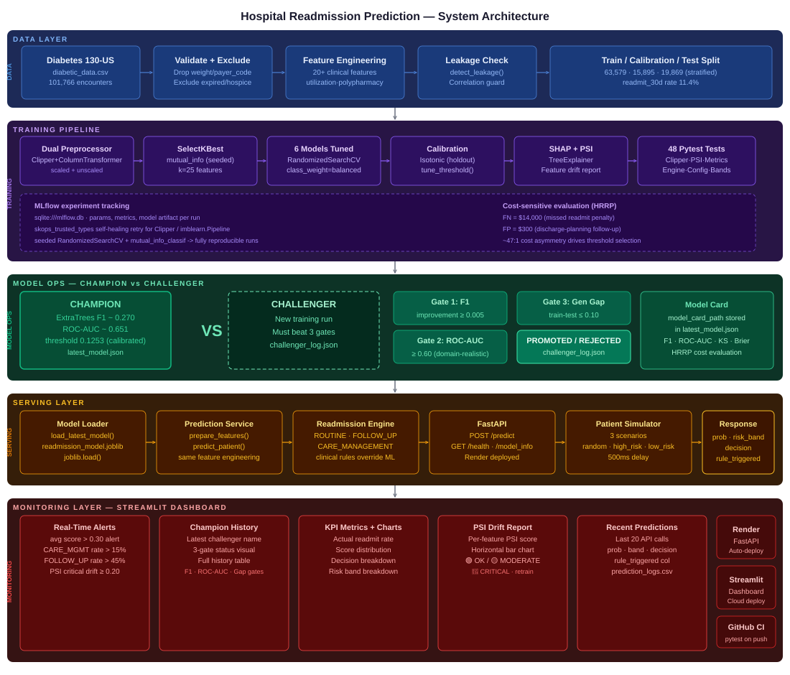

```
╔══════════════════════════════════════════════════════════════════════════════════╗
║        HOSPITAL READMISSION PREDICTION — 5-LAYER PRODUCTION SYSTEM               ║
╠══════════════════════════════════════════════════════════════════════════════════╣
║                                                                                  ║
║  ┌─────────────────────────────── DATA LAYER ──────────────────────────────┐     ║
║  │  diabetic_data.csv → Validate + Exclude → Feature Engineering → Leakage │     ║
║  │  101,766 encounters · exclude expired/hospice · 63K/16K/20K stratified  │     ║
║  └───────────────────────────────────┬─────────────────────────────────────┘     ║
║                                      ▼                                           ║
║  ┌─────────────────────────── TRAINING PIPELINE ───────────────────────────┐     ║
║  │  Dual Preprocessor → SelectKBest (seeded) → 6 Models Tuned → Calibration│     ║
║  │  Clipper+ColumnTransformer   mutual_info k=25   RandomizedSearchCV      │     ║
║  │  SHAP + PSI drift report → MLflow tracking → 48 pytest tests            │     ║
║  └───────────────────────────────────┬─────────────────────────────────────┘     ║
║                                      ▼                                           ║
║  ┌──────────────────────── CHAMPION-CHALLENGER ────────────────────────────┐     ║
║  │  Gate 1: F1 improvement ≥ 0.005   Gate 2: ROC-AUC ≥ 0.60                │     ║
║  │  Gate 3: train-test gap ≤ 0.10 → ALL PASS → PROMOTED, else REJECTED     │     ║
║  └───────────────────────────────────┬─────────────────────────────────────┘     ║
║                                      ▼                                           ║
║  ┌──────────────────────────── SERVING LAYER ──────────────────────────────┐     ║
║  │  Model Loader → Prediction Service → Readmission Engine → FastAPI       │     ║
║  │  POST /predict → ROUTINE_DISCHARGE / FOLLOW_UP_REQUIRED / CARE_MGMT     │     ║
║  └───────────────────────────────────┬─────────────────────────────────────┘     ║
║                                      ▼                                           ║
║  ┌─────────────────── MONITORING LAYER — STREAMLIT DASHBOARD ──────────────┐     ║
║  │  Alerts · Champion-Challenger history · KPIs · PSI drift · Predictions  │     ║
║  └─────────────────────────────────────────────────────────────────────────┘     ║
╚══════════════════════════════════════════════════════════════════════════════════╝
```

---

## 📸 Dashboard Screenshots

### 🖥️ Full Dashboard UI

Real-time readmission risk dashboard — live sidebar prediction · Champion-Challenger system · KPI cards · PSI drift · prediction audit log.

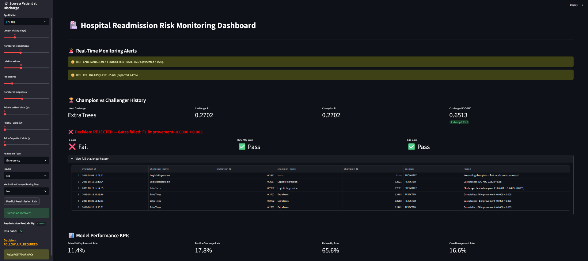

---

### 🎯 Risk Band & Score — Live Prediction

Sidebar discharge-planning prediction — readmission probability, threshold-relative risk band, and discharge decision for a single patient.

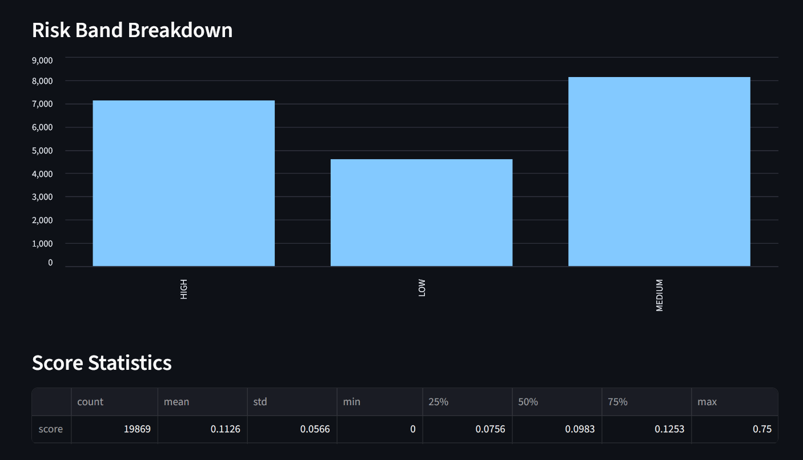

---

### 📊 Model Performance KPIs

Actual readmit rate · routine/follow-up/care-management rates · readmission score distribution with LOW/MEDIUM/HIGH band cutoffs.

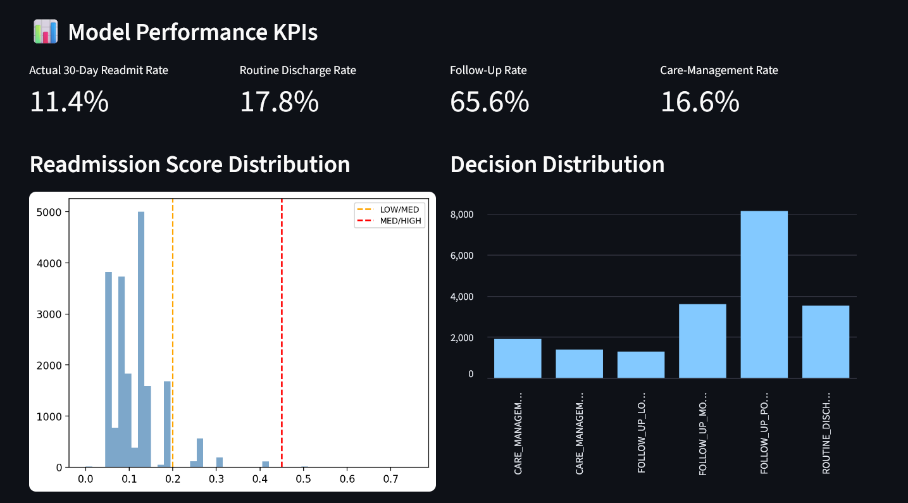

---

### 📈 Feature Drift Report (PSI)

Per-feature Population Stability Index between train and test — all features 🟢 OK (PSI &lt; 0.10), confirming no distribution shift on this stratified split.

.png)

---

### 📉 Feature PSI Drift Scores

Full PSI table sorted by drift score — `num_medications` highest at 0.0015, still two orders of magnitude below the 0.10 moderate-drift threshold.

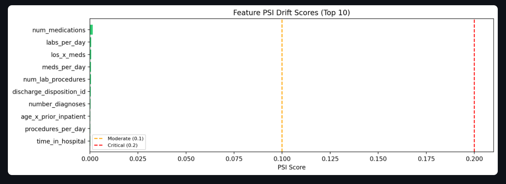

---

### 📋 Recent Predictions Log

Last API predictions — probability · risk band · decision · rule triggered, sourced from `logs/prediction_logs.csv`.

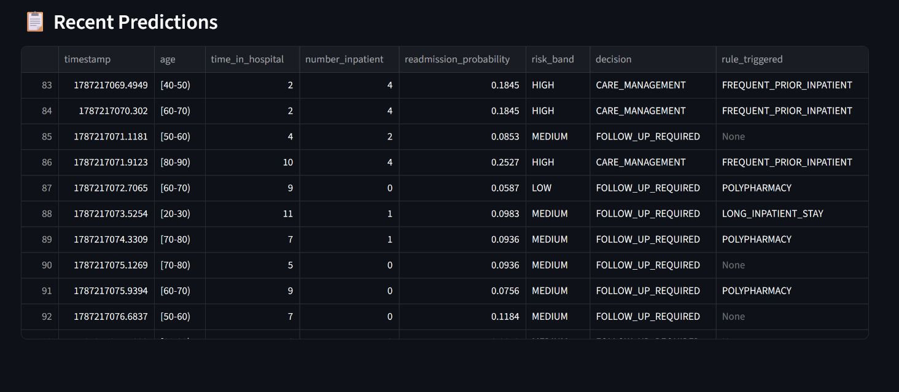

---

## 📊 Training Reports

| Confusion Matrix | ROC / PR Curves |
|---|---|
| 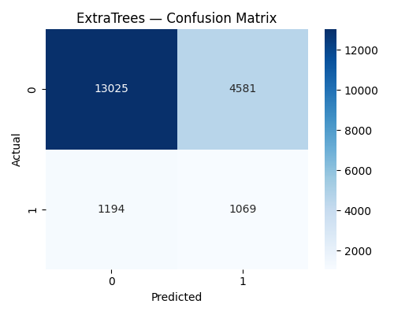 | 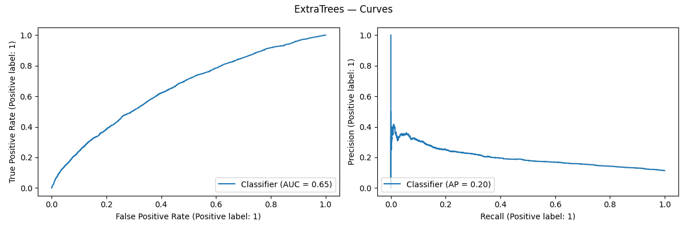 |

| SHAP Summary | Champion-Challenger Evaluation |
|---|---|
| 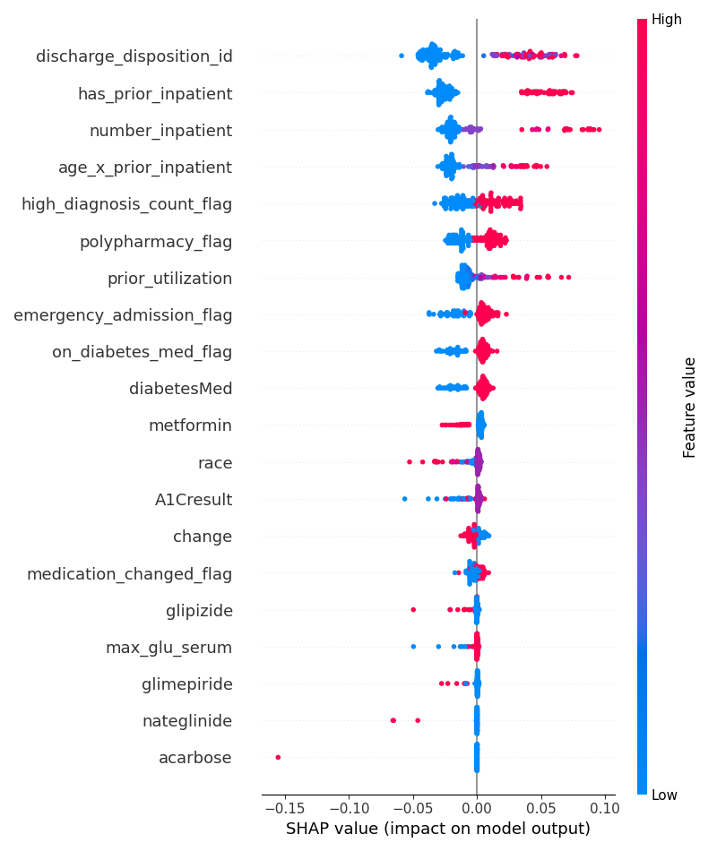 | 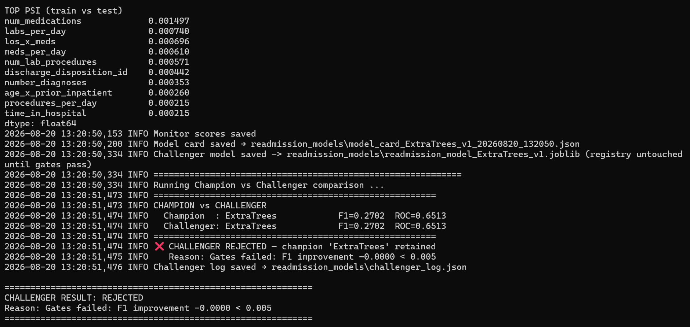 |

| Test Coverage | Simulation Run |
|---|---|
| 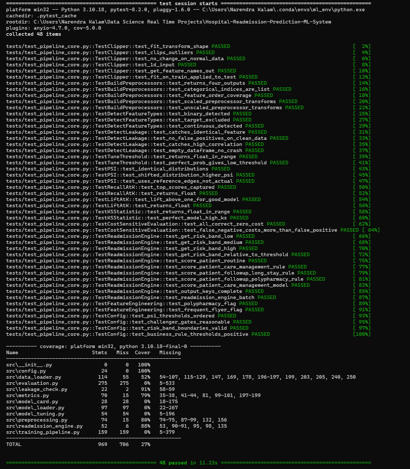 | 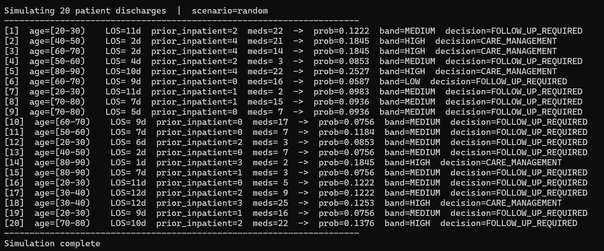 |

| Training & Evaluation Summary |
|---|
| 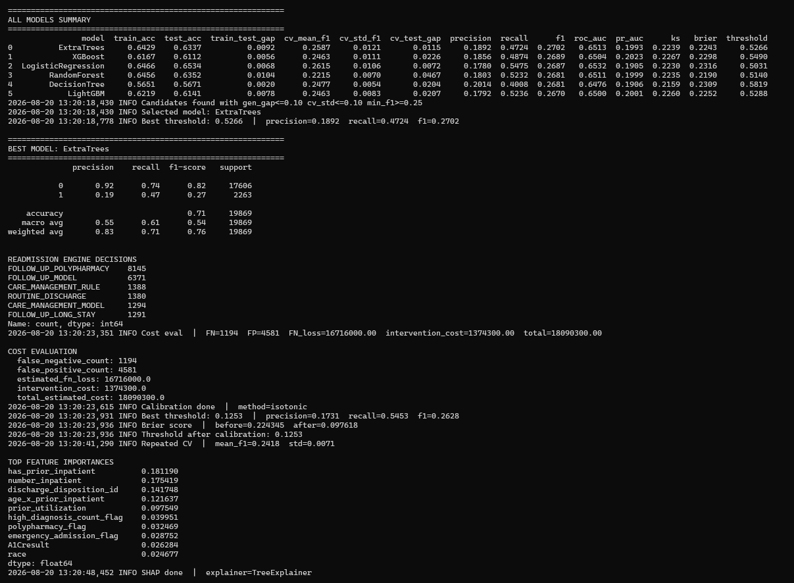 |

---

## 🎬 System Demo

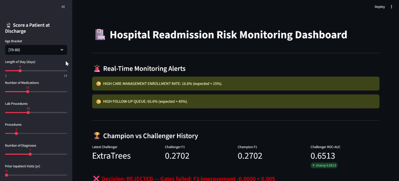

---

## 📁 Project Structure

```
Hospital-Readmission-Prediction-ML-System/
│
├── src/                                     # Core ML system
│   ├── config.py                            # Risk bands, business rules, PSI/challenger thresholds
│   ├── data_loader.py                       # Validation · terminal-discharge exclusion · feature engineering
│   ├── preprocessing.py                     # Clipper (IQR) · dual ColumnTransformer · safe_k
│   ├── model_tuning.py                      # 6-model RandomizedSearchCV grids (seeded mutual_info)
│   ├── metrics.py                           # PSI · KS · recall/lift@k · HRRP cost-sensitive evaluation
│   ├── evaluation.py                        # Model comparison · calibration · SHAP · MLflow logging
│   ├── leakage_check.py                     # Automated leakage guardrail
│   ├── model_card.py                        # Google Model Cards standard JSON
│   ├── model_loader.py                      # Champion-Challenger 3-gate registry
│   ├── readmission_engine.py                # 3-tier clinical decision engine
│   └── training_pipeline.py                 # End-to-end training pipeline
│
├── serving/
│   └── readmission_api.py                   # FastAPI: /predict · /health · /model_info
│
├── services/
│   └── prediction_service.py                # Feature engineering + engine glue for the API
│
├── monitoring/
│   └── monitoring_dashboard.py              # Streamlit: 5-section monitoring dashboard
│
├── simulation/
│   └── patient_simulator.py                 # 3-scenario synthetic discharge generator
│
├── tests/
│   └── test_pipeline_core.py                # 48 pytest unit tests — all passing
│
├── scripts/
│   ├── train_model.py                       # python scripts/train_model.py
│   ├── run_api.py                           # python scripts/run_api.py
│   ├── run_dashboard.py                     # python scripts/run_dashboard.py
│   └── run_simulation.py                    # python scripts/run_simulation.py
│
├── notebooks/
│   ├── hospital_readmission_eda.ipynb       # Professional EDA — 22 steps
│   └── hospital_readmission_eda.html       
│
├── data/
│   ├── sample_dataset_info.txt                    
│   └── sample_diabetes_readmission_dataset.csv          # representative sample for quick testing
│
├── readmission_models/                      # Model artifacts — JSON files pushed to GitHub
│   ├── latest_model.json                    # Champion model registry
│   ├── challenger_log.json                  # Full Champion-Challenger comparison history
│   ├── model_card_extratrees_v*.json        # Google Model Card JSON
│   ├── model_experiment_results.csv         # All 6 models' metrics
│   ├── monitor_scores.csv                   # Test-set scores + risk band + decision
│   └── feature_drift_report.csv             # PSI drift per feature
│
├── docs/
│   ├── architecture/
│   │   └── hospital_readmission_architecture.svg   # 5-layer system architecture diagram
│   ├── plots/
│   │   ├── confusion_matrix.png                    # Champion model confusion matrix
│   │   ├── roc_pr_curves.png                       # ROC + Precision-Recall curves
│   │   └── shap_summary.png                        # SHAP feature-impact summary
│   ├── screenshots/
│   │   ├── dashboard_full_ui.png                   # Full Streamlit dashboard UI
│   │   ├── risk_band_and_score.png                 # Sidebar live-prediction result
│   │   ├── model_performance_kpis.png              # KPI cards + score distribution
│   │   ├── feature_drift_report(psi).png           # PSI drift status table
│   │   ├── feature_psi_drift_scores.png            # Full PSI drift table + chart
│   │   └── recent_predictions.png                  # Recent predictions audit log
│   ├── reports/
│   │   ├── challenger_evaluation.png               # Champion-Challenger gate results
│   │   ├── simulation.png                          # Simulation run terminal output
│   │   ├── test_coverage.png                       # pytest 48/48 coverage report
│   │   └── training_model_summary.png              # Training summary
│   └── gifs/
│       └── system_demo.gif                         # End-to-end system demo
│
├── logs/
│   └── prediction_logs.csv                  # API prediction audit log (auto-generated)
│
├── Dockerfile                                # FastAPI production image
├── Dockerfile.dashboard                      # Streamlit dashboard container
├── docker-compose.yml                        # API + Dashboard (ports 8000 + 8501)
├── .github/workflows/ci.yml                 # GitHub Actions — pytest on every push
├── .gitignore
├── LICENSE                                   # MIT License
├── README.md                                 # This file
├── render.yaml                               # Render.com deployment config
├── requirements.txt                          # All dependencies
├── requirements_api.txt                      # API-only deployment deps
├── requirements_dashboard.txt                # Dashboard-only deployment deps
└── runtime.txt                               # Python 3.10.13
```

---

## 🚀 Quickstart

### 1. Clone & Install

```bash
git clone https://github.com/narendrakalam2001/Hospital-Readmission-Prediction-ML-System.git
cd Hospital-Readmission-Prediction-ML-System
pip install -r requirements.txt
```

### 2. Get the Dataset

Download `diabetic_data.csv` from the [Diabetes 130-US Hospitals dataset](https://www.kaggle.com/datasets/brandao/diabetes) (Kaggle) or the [UCI ML Repository](https://archive.ics.uci.edu/dataset/296/diabetes+130-us+hospitals+for+years+1999-2008), and place it at `data/diabetic_data.csv`.

```
data/
├── sample_dataset_info.txt             
└── sample_diabetes_readmission_dataset.csv      # sample already included for quick testing
```

### 3. Train Model

```bash
python scripts/train_model.py
```

Expected output:
```
INFO  Data validation passed  | shape=(99343, 44)  readmit_30d_rate=0.114
INFO  Excluded 2423 expired/hospice encounters (non-readmittable)
INFO  Split  | train_fit=63579  cal=15895  test=19869
INFO  Selected model: ExtraTrees
INFO  Best threshold: 0.5266 | precision=0.1892 recall=0.4724 f1=0.2702
INFO  Calibration done | method=isotonic | threshold after calibration: 0.1253
INFO  CHALLENGER RESULT: PROMOTED
INFO  TRAINING COMPLETE  |  Best model: ExtraTrees
```

### 4. Start API

```bash
python scripts/run_api.py
# API:  http://localhost:8000
# Docs: http://localhost:8000/docs
```

### 5. Start Dashboard

```bash
python scripts/run_dashboard.py
# Dashboard: http://localhost:8501
```

### 6. Run Simulation

```bash
python scripts/run_simulation.py
```

### 7. Run Tests

```bash
pytest tests/test_pipeline_core.py -v --cov=src --cov-report=term-missing
# 48 collected · 48 passed
```

---

## 🐳 Docker

```bash
# Start everything
docker compose up --build

# API only
docker compose up api

# Dashboard only
docker compose up dashboard

# Stop
docker compose down
```

| Service | URL |
|---|---|
| FastAPI + Swagger | `http://localhost:8000/docs` |
| Streamlit Dashboard | `http://localhost:8501` |

---

## 🌐 API Reference

### POST /predict — Single Patient Discharge Risk

```bash
curl -X POST "http://localhost:8000/predict" \
  -H "Content-Type: application/json" \
  -d '{
    "age": "[70-80)",
    "time_in_hospital": 9,
    "num_medications": 21,
    "number_inpatient": 3,
    "admission_type_id": 1
  }'
```

**Response:**
```json
{
  "readmission_probability": 0.1845,
  "risk_band": "HIGH",
  "decision": "CARE_MANAGEMENT",
  "rule_triggered": "FREQUENT_PRIOR_INPATIENT",
  "latency_seconds": 0.0142
}
```

### GET /health

```json
{"status": "running", "model_loaded": true}
```

### GET /model_info

Returns the full model registry JSON — champion model name, metrics, calibrated threshold, and model card path.

---

## 📊 All 6 Models — Comparison Table

| Model | Test Acc | Precision | Recall | F1 | ROC-AUC | Brier |
|---|---|---|---|---|---|---|
| **ExtraTrees** ⭐ | 0.6337 | 0.1892 | 0.4724 | **0.2702** | **0.6513** | 0.2243 |
| XGBoost | 0.6112 | 0.1856 | 0.4874 | 0.2689 | 0.6504 | 0.2298 |
| LogisticRegression | 0.6534 | 0.1780 | 0.5475 | 0.2687 | 0.6532 | 0.2316 |
| RandomForest | 0.6352 | 0.1803 | 0.5232 | 0.2681 | 0.6511 | 0.2190 |
| DecisionTree | 0.5671 | 0.2014 | 0.4008 | 0.2681 | 0.6476 | 0.2309 |
| LightGBM | 0.6141 | 0.1792 | 0.5236 | 0.2670 | 0.6500 | 0.2252 |

> All 6 models cluster within ~0.003 F1 and ~0.005 ROC-AUC of each other — expected for this
> low-signal dataset. Tree-ensemble methods (ExtraTrees, XGBoost) edge out linear/single-tree
> baselines marginally, consistent with the mildly non-linear interactions in the engineered
> features (e.g. `age_x_prior_inpatient`).

Full experiment table: `readmission_models/model_experiment_results.csv`

---

## 🏆 Champion vs Challenger — 3-Gate Promotion

Every new training run is compared against the production champion using **3 promotion gates**:

| Gate | Condition | Rationale |
|---|---|---|
| F1 Improvement | Challenger must beat champion by ≥ 0.005 | Meaningful accuracy gain only |
| ROC-AUC Threshold | ≥ 0.60 | Domain-realistic floor — this task's literature ceiling is ~0.65-0.68, not 0.90+ |
| Train-Test Gap | ≤ 0.10 | No overfitting to the training set |

> **Why is the ROC-AUC gate 0.60, not 0.75+ like an easier domain?** A gate copied from a
> different project (e.g. credit risk, where ROC-AUC reaches 0.999) would permanently reject
> every challenger on this dataset — 30-day readmission simply doesn't support that level of
> discrimination. The gate is calibrated to this task's documented literature ceiling instead.

**Real run — Champion-Challenger comparison:**

```
CHAMPION vs CHALLENGER
  Champion  : ExtraTrees   F1=0.2702  ROC=0.6513
  Challenger: ExtraTrees   F1=0.2702  ROC=0.6513
✅ CHALLENGER PROMOTED → new champion: ExtraTrees
Reason: No existing champion — first model auto-promoted
```

Results logged to `readmission_models/challenger_log.json` and visible in the dashboard Section 2 with per-gate ✅/❌ status.

---

## 🩺 Readmission Engine — 3-Tier Discharge Decision

Unlike a raw probability output, this system uses a **3-tier discharge-planning decision** with clinical rules that run **before** the ML score:

| Decision | Trigger | Priority |
|---|---|---|
| `CARE_MANAGEMENT` | `number_inpatient ≥ 3` (rule) **or** `prob ≥ threshold` (model) | 🔴 Enroll in transitional care |
| `FOLLOW_UP_REQUIRED` | `time_in_hospital ≥ 10` **or** `num_medications ≥ 15` (rules) **or** `prob ≥ 0.6×threshold` | 🟡 Schedule follow-up call / clinic visit |
| `ROUTINE_DISCHARGE` | None of the above | 🟢 Standard discharge |

**Risk band is threshold-relative, not fixed** — `HIGH` if `prob ≥ threshold`, `MEDIUM` if `prob ≥ 0.6×threshold`, `LOW` otherwise. This guarantees the displayed risk band can never contradict the discharge decision, even as the calibrated threshold moves between training runs.

**Real test-set decision breakdown (n=19,869):**

| Decision | Count | % |
|---|---|---|
| FOLLOW_UP_POLYPHARMACY (rule) | 8,145 | 41.0% |
| FOLLOW_UP_MODEL | 6,371 | 32.1% |
| CARE_MANAGEMENT_RULE (frequent flyer) | 1,388 | 7.0% |
| ROUTINE_DISCHARGE | 1,380 | 6.9% |
| CARE_MANAGEMENT_MODEL | 1,294 | 6.5% |
| FOLLOW_UP_LONG_STAY (rule) | 1,291 | 6.5% |

---

## 💰 HRRP Cost-Sensitive Evaluation (Real Test-Set Run)

| | Count | Estimated Cost |
|---|---|---|
| False Negatives (missed readmission) | 1,194 | $16,716,000 |
| False Positives (unnecessary intervention) | 4,581 | $1,374,300 |
| **Total estimated cost** | | **$18,090,300** |

Assumes **$14,000** average CMS penalty + re-treatment cost per missed readmission vs. **$300** per discharge-planning follow-up — a **~47:1 cost asymmetry** that pushes threshold selection toward higher recall (catch more true readmissions) even at the expense of more false alarms.

---

## 🔬 Top Feature Importances (Champion Model)

| Feature | Importance |
|---|---|
| `has_prior_inpatient` | 0.1812 |
| `number_inpatient` | 0.1754 |
| `discharge_disposition_id` | 0.1417 |
| `age_x_prior_inpatient` | 0.1216 |
| `prior_utilization` | 0.0975 |
| `high_diagnosis_count_flag` | 0.0400 |
| `polypharmacy_flag` | 0.0325 |
| `emergency_admission_flag` | 0.0288 |
| `A1Cresult` | 0.0263 |
| `race` | 0.0247 |

> Confirms the EDA hypothesis: **prior healthcare utilization** (inpatient visits, discharge
> disposition, age-utilization interaction) is by far the strongest readmission signal — well
> ahead of diagnosis codes or medication details. See `docs/plots/shap_summary.png` for the full
> SHAP breakdown.

---

## 📈 PSI Drift Monitoring (Train vs Test)

| Feature | PSI | Status |
|---|---|---|
| `num_medications` | 0.0015 | 🟢 OK |
| `labs_per_day` | 0.0007 | 🟢 OK |
| `los_x_meds` | 0.0007 | 🟢 OK |
| `meds_per_day` | 0.0006 | 🟢 OK |
| `num_lab_procedures` | 0.0006 | 🟢 OK |
| `discharge_disposition_id` | 0.0004 | 🟢 OK |
| `number_diagnoses` | 0.0004 | 🟢 OK |

All features well below the 0.10 (moderate) and 0.20 (critical) PSI thresholds — expected, since train/test come from a stratified split of the same population rather than a genuine temporal shift. See `docs/screenshots/feature_drift_report(psi).png`.

---

## 🧪 Test Coverage

```
48 tests collected across 12 test classes:

  TestClipper                (6)  — fit/transform shape · clips outliers · no-op on normal data ·
                                    1D input · get_feature_names_out · train-fit-applied-to-test (no leakage)
  TestBuildPreprocessors      (5)  — 4 outputs · categorical indices · feature order coverage ·
                                    scaled/unscaled transforms produce no NaNs
  TestDetectFeatureTypes      (3)  — binary detected · target excluded · continuous detected
  TestDetectLeakage           (4)  — catches identical feature · no false positives on clean data ·
                                    catches high correlation · empty dataframe no crash
  TestTuneThreshold            (2)  — returns float in range · perfectly-separated data gives low threshold
  TestPSI                      (3)  — identical distributions · shifted distribution higher PSI ·
                                    uses reference edges not actual
  TestRecallAtK                (2)  — top scores captured · returns float
  TestLiftAtK                  (2)  — lift above 1 for good model · returns float
  TestKSStatistic               (2)  — returns float in range · perfect model gives high KS
  TestCostSensitiveEvaluation   (2)  — all-correct zero cost · FN costs more than FP
  TestReadmissionEngine        (11)  — risk band low/medium/high · risk band relative to threshold
                                    (regression test for the LOW-band/CARE_MANAGEMENT mismatch fix) ·
                                    routine/rule/model decisions · batch engine
  TestFeatureEngineering        (2)  — polypharmacy flag · frequent flyer flag
  TestConfig                    (4)  — PSI thresholds ordered · challenger gates reasonable ·
                                    risk band boundaries valid · business rule thresholds positive

Result: 48 passed · 0 failed
```


---

## 🧠 Technical Standards

| Component | Implementation |
|---|---|
| **Champion Model** | ExtraTrees — `class_weight='balanced'`, tuned via RandomizedSearchCV |
| **Preprocessing** | Clipper (IQR-based outlier clipping, fit-on-train only) + dual ColumnTransformer (scaled for linear, unscaled for trees) |
| **Feature Selection** | `SelectKBest(mutual_info_classif, k=25)` — explicitly seeded (`random_state=42`) for run-to-run reproducibility |
| **Imbalance Handling** | `class_weight='balanced'` / `is_unbalance` / `scale_pos_weight` across all 6 models — 11.4% positive class |
| **Calibration** | Isotonic regression on a held-out calibration split (sigmoid fallback for small cal sets) |
| **Threshold Tuning** | `tune_threshold()` — F1-maximizing, re-run post-calibration |
| **Explainability** | SHAP — `TreeExplainer` for tree/boosting champions, `KernelExplainer` fallback for linear champions |
| **Drift Monitoring** | PSI — correct edge-based implementation (bins computed on reference distribution) |
| **Leakage Detection** | Automated correlation + identical-feature guard before every training run |
| **Cost-Sensitive Evaluation** | HRRP penalty ($14K) vs. intervention cost ($300) — not naive accuracy |
| **Model Card** | Google Model Cards standard — JSON with metrics, thresholds, dataset stats |
| **Experiment Tracking** | MLflow — SQLite backend, self-healing `skops_trusted_types` retry for custom pipeline objects |
| **Champion-Challenger** | 3-gate: F1 improvement ≥ 0.005 · ROC-AUC ≥ 0.60 (domain-calibrated) · gap ≤ 0.10 |
| **CI/CD** | GitHub Actions — pytest on every push |
| **Deployment** | Render.com (FastAPI) + Streamlit Cloud (Dashboard) |

---

## 🩺 Data Quality Decisions

| Issue Found | Decision | Why |
|---|---|---|
| `weight` 97% missing, `payer_code` 40% missing | Dropped | Not enough signal to impute reliably |
| `examide`, `citoglipton` zero-variance | Dropped | Single value across all 101,766 rows |
| Expired / hospice discharges (disposition codes 11,13,14,19,20,21) | **Excluded** (~2.4% of rows) | These patients structurally cannot be readmitted — including them is silent label noise |
| `race` / `medical_specialty` / `diag_*` missingness | Encoded as `"Missing"` category | Missingness itself is informative in EHR data; dropping rows biases toward well-documented patients |
| 700-900 unique ICD-9 codes per diagnosis slot | Grouped into 8 clinical buckets | Too sparse to one-hot encode directly |
| 11.4% positive class rate | `class_weight='balanced'` everywhere | Never trained on raw accuracy |

---

## 🛡️ Ethical Considerations

- Model outputs are a discharge-planning aid, not a clinical diagnosis — final decisions require a qualified clinician
- The 11.4% readmission base rate means most flagged "high-risk" patients will not actually be readmitted (expected precision ≈ 0.19) — the system is tuned to catch more true readmissions at the cost of more false alarms, per the HRRP cost asymmetry
- NIH/UCI diabetes readmission labels reflect 1999–2008 US hospital practice patterns and payer mix — performance may not transfer directly to other health systems or eras without recalibration
- Several medication columns are &gt;99% "No" (e.g. `miglitol`) — rare-category coefficients showed some instability in the linear model candidate during evaluation and should be monitored if Logistic Regression is ever promoted
- Regular fairness audits recommended — race and medical_specialty are model inputs; performance should be checked for disparate impact across these groups before any production rollout
- Not validated for pediatric encounters, non-diabetic populations, or hospitals outside the original 130-hospital sample

---

## 👨‍💻 About

**Narendra Kalam** — MSc Computer Science (Gold Medalist — NASSCOM, Full Stack Data Science + AI)

> Building 20+ industry-level, end-to-end ML systems across all domains.

[](https://www.linkedin.com/in/narendra-kalam/)
[](https://www.kaggle.com/narendrakalam)
[](https://narendrakalam2001.github.io/)
[](mailto:kalamnarendra2001@gmail.com)

### Portfolio Projects

| # | Project | Domain | Champion Model | Key Metric |
|---|---|---|---|---|
| 1 | Credit Card Fraud Detection | BFSI / Fintech | ExtraTrees | F1 = 0.8962 · 284K transactions |
| 2 | Credit Risk Prediction | BFSI / Lending | LightGBM | F1 = 0.9741 · ROC-AUC = 0.9991 |
| 3 | Customer Churn Prediction | Telecom / BFSI | CatBoost | F1 = 0.634 · Recall = 0.7312 |
| 4 | House Price Prediction | Real Estate | CatBoost | RMSE = $20,128 · R² = 0.9053 |
| 5 | Store Sales Forecasting | Retail / Supply Chain | LightGBM (Ensemble) | RMSLE = 0.3739 · R² = 0.9761 |
| 6 | Energy Demand Forecasting | Energy / Utilities | ElasticNet | RMSE = 712.04 MW · R² = 0.9759 |
| 7 | Stock Price & Risk Forecasting | Fintech / Capital Markets | Ridge | DirAcc = 53.44% · Sharpe = 0.80 |
| 8 | Resume Screener AI | HR Tech | LightGBM | F1 = 0.7608 · Top-3 = 0.9416 |
| 9 | ABSA Sentiment Analysis | E-Commerce / Banking | RidgeClassifier | Macro-F1 = 0.6212 · ROC-AUC = 0.823 |
| 10 | Fake News Detector | Media Tech / Gov Tech | XGBoost | F1 = 0.9993 · ROC = 1.0000 |
| 11 | BC5CDR Clinical NER | Biomedical NLP | BioBERT | F1 = 0.8847 · Chemical F1 = 0.9239 |
| 12 | News Topic Modeling | Media Analytics | LDA (Gensim) | Cv = 0.6225 · Diversity = 0.92 |
| 13 | Chest X-Ray Diagnosis | Healthcare AI | DenseNet121 | Mean AUC = 0.7864 · 14 classes |
| 14 | Real-Time Object Detection | Computer Vision / Retail-Security | YOLOv8s | mAP50-95 = 0.5341 · 32 FPS |
| 15 | Face Emotion Recognition | EdTech / Retail CX | CNN-from-scratch | Macro-F1 = 0.5950 · 7 classes |
| 16 | Customer Segmentation Engine | E-Commerce / BFSI | DBSCAN (Unsupervised) | Silhouette = 0.4056 |
| 17 | Market Basket Analysis (Instacart) | Retail / Quick-Commerce | Apriori | 68,820 rules · mean lift = 15.66 |
| 18 | E-Commerce / OTT Recommender | E-Commerce / Streaming | Hybrid (SVD + Content) | NDCG@10 = 0.0407 · 4 candidates |
| 19 | **Hospital Readmission Prediction** | **Healthcare / Hospital Ops** | **ExtraTrees** | **F1 = 0.2702 · ROC-AUC = 0.6513** |

---

## 📚 References

- Strack, B., et al. (2014) — [Impact of HbA1c Measurement on Hospital Readmission Rates: Analysis of 70,000 Clinical Database Patient Records](https://www.hindawi.com/journals/bmri/2014/781670/), *BioMed Research International*
- Centers for Medicare & Medicaid Services — [Hospital Readmissions Reduction Program (HRRP)](https://www.cms.gov/medicare/quality/value-based-programs/hospital-readmissions)
- Diabetes 130-US Hospitals Dataset — [Kaggle](https://www.kaggle.com/datasets/brandao/diabetes) · [UCI ML Repository](https://archive.ics.uci.edu/dataset/296/diabetes+130-us+hospitals+for+years+1999-2008)

---

## 📄 License

MIT License — see [LICENSE](LICENSE)